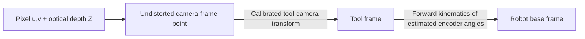
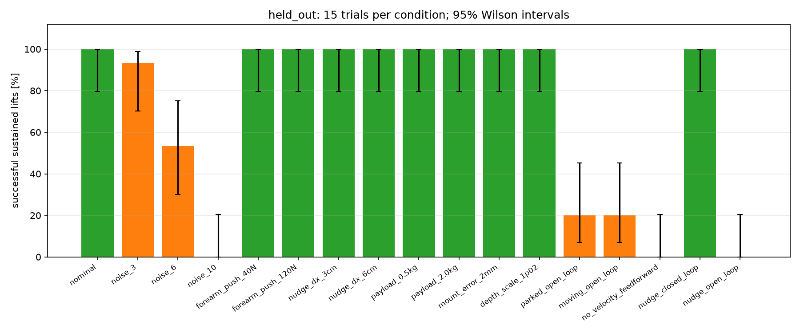
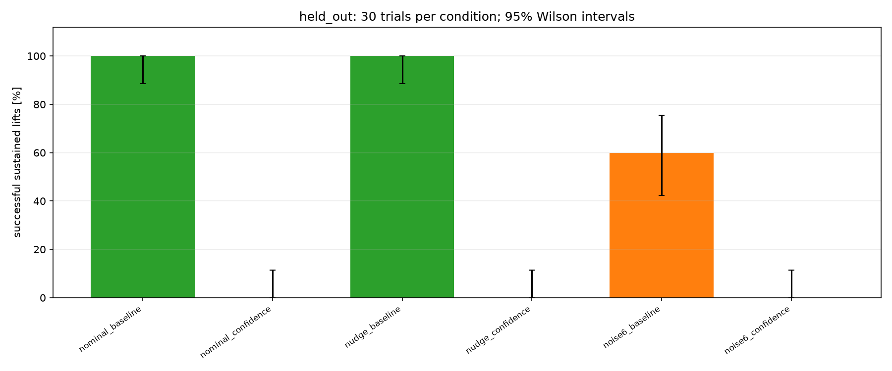

# Track B — UR3 vision-guided moving-target pick

**UTS 41014 Sensors and Control in Mechatronics Systems — Assessment 4**

A wrist RGB-D camera locates a red block travelling across a clear table. Joint and object Kalman filters estimate unmeasured velocities. Position-based visual servoing (PBVS), velocity feedforward and computed torque with LQR drive a physical parallel gripper to intercept, grasp and lift the block in MuJoCo.

[Watch the demonstration](https://youtu.be/rQuGVwgUpcU) · [Portfolio page](https://pranavachalla-UTS.github.io/SensorsAndControls/) · [Code and technical report](project/)

## Current verification status

<!-- VALIDATION:START -->
Latest runner status: **complete**.

Passed stages: `tests.py`, `part_a_model.py`, `part_b_sensing.py`, `part_c_estimation.py`, `part_d_control.py`, `part_e_robustness.py`, `part_e_robustness.py`.

[Machine-readable validation record](project/results/validation.json). Full stage logs are under `results/execution/`.
<!-- VALIDATION:END -->

## Install and reproduce

Use a separate environment so existing Conda packages do not override the tested versions. From the repository root:

```sh
python3 -m venv .venv
source .venv/bin/activate
python -m pip install -r project/requirements.txt
python project/run_all.py --quick --no-video
```

That command runs regression tests, the arm model, calibration, estimation, control and six development trials per condition. It stops at the first failed prerequisite. For final studies:

```sh
python project/run_all.py --held-out --confidence-study
```

The full command runs 15 held-out trials per robustness condition and a separate 30-trial-per-condition baseline/confidence comparison. The compared policies reuse the same held-out initial placements. `--quick` is a smoke check, not final repeated-trial evidence.

**Graphics are required** for camera calibration and vision-guided trials. On macOS a normal local Terminal session should have access to the desktop graphics system. If MuJoCo reports `invalid CoreGraphics connection`, resolve the graphics connection before proceeding; dependent studies are deliberately not run with fallback calibration.

The requirement pins include OpenCV 4.14.0.94. OpenCV 5 removed the hand-eye API used here. Older and newer MuJoCo mass-matrix interfaces are supported; regression tests check the active environment.

### Useful individual commands

```sh
python project/tests.py
python project/part_a_model.py
python project/part_b_sensing.py
python project/part_c_estimation.py
python project/part_d_control.py
python project/part_e_robustness.py --held-out
python project/part_e_robustness.py --confidence-study
mjpython project/watch.py --seed 4 --nudge
mjpython project/make_video.py --seed 4
mjpython project/make_video.py --seed 4 --nudge
python project/update_project_page.py
```

On macOS use `.venv/bin/mjpython` for the interactive viewer if it is not on PATH. Calibration must complete before a normal pick. Nominal fallback is available only through the explicitly labelled development API `run_pick(allow_nominal=True)`; it is not assessment evidence.

## A — Modelling

The smooth arm model obeys `M(q) q_ddot + c(q,q_dot) + g(q) + B q_dot = tau`. It includes the imported UR3, motor armature and gripper. At the observation pose, the linearised state is six angle perturbations and six velocities:

```text
A = [       0          I ]    B_u = [  0  ]    C = [ I  0 ]
    [ -M^-1 dg/dq  -M^-1 B ]          [ M^-1 ]
```

Part A checks controllability and observability with a PBH test rather than relying only on a poorly conditioned controllability matrix. It saves the matrices, poles, gains and a local perturbation check in `results/model_report.json` and `results/model_matrices.npz`. These are local smooth-model results; they do not prove global/contact stability.

## B — Calibrated sensing and frames

The camera provides 640×480 RGB-D at about 15 Hz. Intrinsics and hand-eye parameters are fitted from 24 checkerboard views; six additional views are reserved for validation. Tsai, Park and Daniilidis hand-eye solvers are compared on training-board scatter only. Validation views are excluded from fitting and selection.



MuJoCo uses right/up/backward camera axes; the optical convention is right/down/forward. The sign conversion is explicit. Colour segmentation and depth locate the block centre and long-axis orientation. Fitted distortion is applied during back-projection.

Depth noise includes independent pixel noise, a smooth per-frame spatial field and missing pixels. **Disparity quantisation is not implemented.** Part B measures repeatability and bias separately, and fits range-dependent total RMS error for the object filter's measurement covariance. Covering bias with R does not remove the bias; bias correction remains an extension to test.

## C — Two observers

- Six joint KFs estimate `[angle, velocity, unmodelled acceleration]` from noisy, quantised position encoders. Velocity is not measured.
- The object KF estimates `[x,y,z,yaw,vx,vy,vz,yaw_rate]` from camera pose measurements. It predicts between frames, gates outliers and can reinitialise after four consecutive large innovations.
- Q and R are stated in the code. The object R varies with range; the joint R includes encoder noise and quantisation variance.
- Joint truth, corrected estimates and covariance are logged at the same **pre-step** time. NEES and RMSE are calculated from aligned quantities. The previous timing-mismatched NEES claims are retired.

Part C compares velocity estimation with encoder differencing and disturbance cancellation with it disabled. It saves tuning rows and numerical results in `results/estimation_report.json`. Its tuning sweep uses development seed 0 and is not a held-out consistency study.

## D — Estimated-state control and physical grasp

Estimated-state computed torque approximately decouples the arm. A discrete LQR is weighted using tolerated position, velocity and acceleration errors. The task-level PBVS uses the estimated block pose and feeds forward estimated block velocity. A damped Jacobian maps tool motion into joint references, with acceleration and torque limits.

The two fingers close with a force-limited servo. Both simulated pad-contact sensors must confirm contact before belt drive is released and lifting begins. Evaluation requires the block to remain at least 80 mm above its starting height for a 0.5 s hold while staying within 60 mm of the TCP. A momentary lift or completion of the state machine alone is insufficient.

The baseline grasp policy uses estimated pose tolerance. The **experimental confidence policy** additionally requires a recent visual update and a two-sigma planar uncertainty ellipse fitting within a 12 mm margin. It may abort more often; improved success is not assumed. The held-out comparison reports both outcomes and cycle times.

## E — Results and robustness

<!-- RESULTS:START -->
### Repeated-trial study

Split: `held_out`. Seeds: 1000–1014. Errors below use all attempts with a defined measurement, including failures.

| Condition | Sustained lifts | 95% Wilson interval | Grasp error, all defined attempts [mm] | Cycle time, all attempts [s] |
| --- | ---: | --- | ---: | ---: |
| nominal | 15/15 | 79.6–100.0% | 4.39 | 11.50 |
| noise_3 | 14/15 | 70.2–98.8% | 10.06 | 11.70 |
| noise_6 | 8/15 | 30.1–75.2% | 18.91 | 11.47 |
| noise_10 | 0/15 | 0.0–20.4% | 19.80 | 9.22 |
| forearm_push_40N | 15/15 | 79.6–100.0% | 3.67 | 11.50 |
| forearm_push_120N | 15/15 | 79.6–100.0% | 3.74 | 11.50 |
| nudge_dx_3cm | 15/15 | 79.6–100.0% | 4.02 | 11.51 |
| nudge_dx_6cm | 15/15 | 79.6–100.0% | 4.40 | 11.69 |
| payload_0.5kg | 15/15 | 79.6–100.0% | 3.49 | 11.49 |
| payload_2.0kg | 15/15 | 79.6–100.0% | 4.31 | 11.49 |
| mount_error_2mm | 15/15 | 79.6–100.0% | 6.39 | 11.49 |
| depth_scale_1p02 | 15/15 | 79.6–100.0% | 3.26 | 11.56 |
| parked_open_loop | 3/15 | 7.0–45.2% | 62.81 | 11.63 |
| moving_open_loop | 3/15 | 7.0–45.2% | 23.39 | 10.67 |
| no_velocity_feedforward | 0/15 | 0.0–20.4% | — | 8.77 |
| nudge_closed_loop | 15/15 | 79.6–100.0% | 3.65 | 11.56 |
| nudge_open_loop | 0/15 | 0.0–20.4% | 55.32 | 10.26 |

[Raw records, settings and provenance](project/results/runs/heldout-20261106T113030Z-428753000/study.json). NPZ time histories regenerate with the same command and are retained locally.



Failure counts: noise_3: {'did not lift it': 1}; noise_6: {'grasp not confirmed by both finger contact sensors': 7}; noise_10: {'align took too long': 14, 'grasp not confirmed by both finger contact sensors': 1}; parked_open_loop: {'grasp not confirmed by both finger contact sensors': 7, 'descend took too long': 4, 'did not lift it': 1}; moving_open_loop: {'descend took too long': 4, 'did not lift it': 2, 'grasp not confirmed by both finger contact sensors': 6}; no_velocity_feedforward: {'align took too long': 15}; nudge_open_loop: {'descend took too long': 4, 'grasp not confirmed by both finger contact sensors': 9, 'did not lift it': 2}.

### Held-out confidence-policy comparison

Split: `held_out`. Seeds: 1000–1029. Errors below use all attempts with a defined measurement, including failures.

| Condition | Sustained lifts | 95% Wilson interval | Grasp error, all defined attempts [mm] | Cycle time, all attempts [s] |
| --- | ---: | --- | ---: | ---: |
| nominal_baseline | 30/30 | 88.6–100.0% | 4.38 | 11.48 |
| nominal_confidence | 0/30 | 0.0–11.4% | — | 8.81 |
| nudge_baseline | 30/30 | 88.6–100.0% | 4.44 | 11.56 |
| nudge_confidence | 0/30 | 0.0–11.4% | — | 8.90 |
| noise6_baseline | 18/30 | 42.3–75.4% | 21.91 | 11.79 |
| noise6_confidence | 0/30 | 0.0–11.4% | — | 9.68 |

[Raw records, settings and provenance](project/results/runs/heldout-confidence-20261106T114113Z-424290000/study.json). NPZ time histories regenerate with the same command and are retained locally.



Failure counts: nominal_confidence: {'grasp aborted: target uncertainty or stale vision': 30}; nudge_confidence: {'grasp aborted: target uncertainty or stale vision': 30}; noise6_baseline: {'grasp not confirmed by both finger contact sensors': 12}; noise6_confidence: {'grasp aborted: target uncertainty or stale vision': 29, 'descend took too long': 1}.

### Held-out calibration

Fit/solver selection used 24 views; 6 separate views were held out.
Held-out reprojection RMS: **0.074 px**. Fixed-board scatter RMS: **0.064 mm**.
[Calibration report](project/results/calibration_report.json) · [Noise measurements](project/results/noise_report.json)

### Model, observer and controller checks

At the reported operating point, controllability and observability ranks are **12/12** and **12/12**. This is a local smooth-model result; contacts and saturation are outside that proof.

On the Part C seed-0 development trial, velocity RMSE was **39.60 mrad/s** for the observer versus **362.18 mrad/s** for encoder differencing. Mean time-aligned joint NEES was **1.392** for the angle and velocity states checked by the per-joint filter (reference value: 2). A mean below 2 suggests conservative uncertainty on this trial; it is not a multi-trial consistency proof.

The Part D trial recorded peak joint torque **23.33 Nm**. LQR gains are kp=941.78, kd=57.47. The weight sweep is a compensated double-integrator analysis, not repeated nonlinear robot trials.

[Model report](project/results/model_report.json) · [Observer report](project/results/estimation_report.json) · [Control report](project/results/control_report.json)
<!-- RESULTS:END -->

Every completed trial saves settings, seed, success/failure reason, contact/hold metrics, error measures, code hashes, source revision, software versions and calibration hashes as JSON. Full measurement/state/covariance histories are saved as compressed NPZ alongside them. Large histories remain local and regenerate from the same commands. Every study uses a new folder, so another run cannot silently overwrite it.

Success intervals use the 95% Wilson method. Error summaries include both successful-only and all-defined-attempt populations. Execution failures are recorded as execution errors and stop the study; they are not disguised as failed physical grasps.

### Limits and next experiments

The block is rectangular, lies flat and is the only red object. The table is clear; obstacle avoidance and arm self-collision checking are outside the validated scope. The conveyor is idealised by enforcing block velocity while it is active. A nudge is a position displacement, not a simulated impact force. Camera occlusion near contact and uncertain extrapolation remain important limits.

The robustness suite also injects a 2 mm calibration-mount error and a 2% depth-scale error. The moving-target/velocity-feedforward and visual-feedback ablations provide the independent-contribution argument. The additional confidence-policy comparison must earn its conclusion from held-out evidence. No hardware performance or guaranteed mark is claimed.

## Evidence from the earlier revision

[Archived original recordings, figures and project page](project/results/legacy_before_review/) are preserved. They predate corrected estimator timing, strict calibration and sustained-lift checks. Their numerical claims are historical, not validation of this revision. The saved original clips do not embed a seed.

## Five-minute demonstration video

<!-- VIDEO:START -->
[Watch the demonstration](https://youtu.be/rQuGVwgUpcU)

<!-- Paste your YouTube URL here once uploaded, and state the code/results revision shown. -->
<!-- VIDEO:END -->

## Contribution statement

<!-- CONTRIBUTIONS:START -->
| Member | Actual contribution |
| --- | --- |
| Pranava | Parts A and B; collaborated with Ryan on Part E and the demonstration video. |
| Ryan | Parts C and D; collaborated with Pranava on Part E and the demonstration video. |
<!-- CONTRIBUTIONS:END -->

## Generative AI declaration

<!-- AI:START -->
OpenAI’s ChatGPT was used to explain the content and theory, improve understanding of the task, assist with debugging and provide guidance in complex situations.
<!-- AI:END -->
