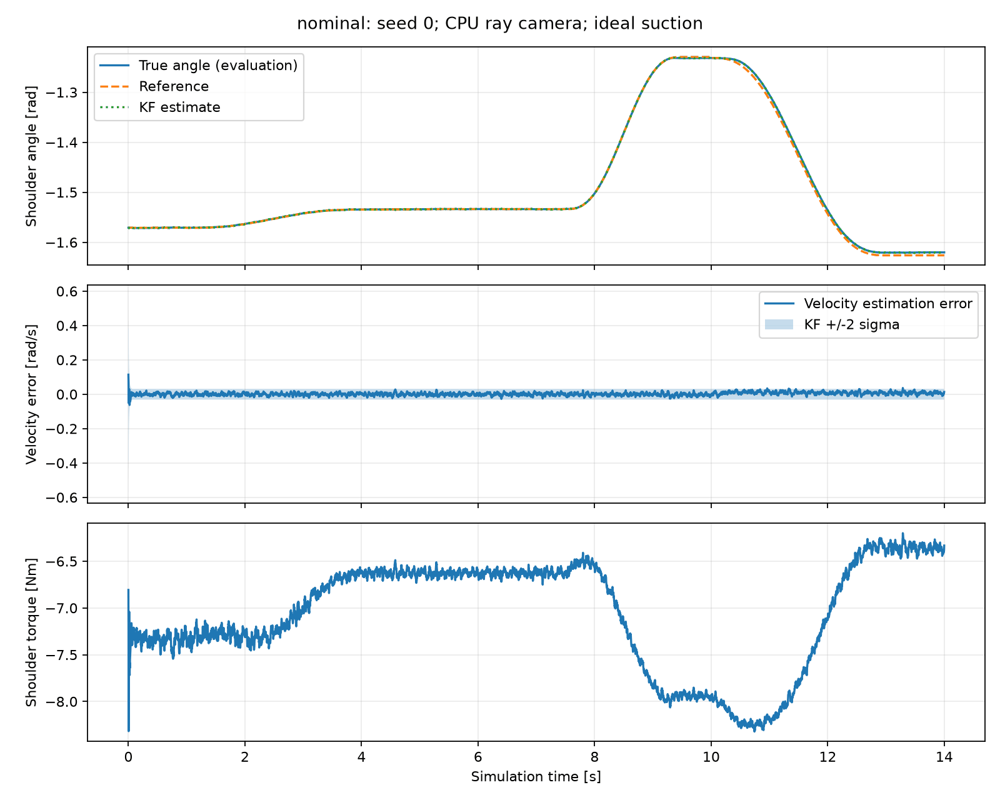
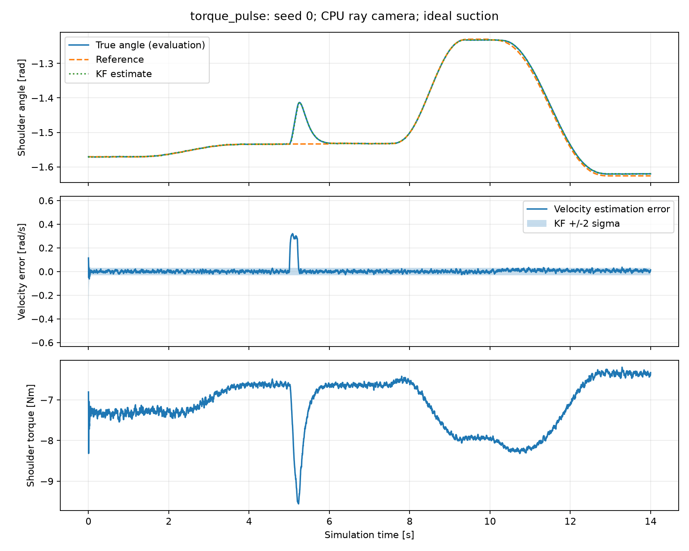

# Measured simulation results

Validated source commit: `ddc35f7e0f90ca73e25aa5500308e2654242dfbd`. Results generated on 6 November 2026 with Python 3.12, MuJoCo 3.17.0, CPU ray RGB-D camera and ideal contact-gated suction. No hardware or OpenGL camera success is claimed.

## Final repeated trials

Seeds 0-9 were reused in each condition. Cube X is uniform within -0.25 +/-0.035 m and Y within +/-0.035 m. Initial target settling, camera captures, observer updates and all movement run in the submitted code. Every trial uses three fresh visual measurements. Success requires contact, attachment, and actual cube centre above 0.70 m throughout a final 0.5 s hold.

| Condition | Picks | First localisation error (mm) | Angle estimate RMSE (rad) | Velocity estimate RMSE (rad/s) | Joint tracking RMSE (rad) | Torque RMS (Nm) |
| --- | --- | --- | --- | --- | --- | --- |
| nominal | 10/10 | 1.061 | 0.000289 | 0.00838 | 0.00285 | 3.949 |
| sensor_noise | 10/10 | 3.224 | 0.000824 | 0.01186 | 0.00335 | 3.949 |
| dropout | 10/10 | 1.108 | 0.000324 | 0.00852 | 0.00287 | 3.949 |
| torque_pulse | 10/10 | 1.061 | 0.000382 | 0.01853 | 0.00829 | 3.967 |

Nominal noise: encoder standard deviation 0.001 rad, depth standard deviation 0.001 m. Sensor-noise condition: 0.004 rad and 0.005 m. Dropout condition: each complete encoder packet is independently absent with probability 0.25 at 500 Hz. Torque-pulse condition: +2 Nm applied to shoulder lift between simulation times 5.0 and 5.2 s. Disturbance is applied to the plant only and is not provided to the observer.

Each 10/10 result has a 95% Wilson success interval of 72.2%-100%. The small shared development seed set and narrow placement range limit generalisation. Conditions vary one factor group at a time; combined severe disturbances were not tested. Localisation errors in this table refer to the first capture, not the corrected final target.

The pulse increases tracking error and unmeasured-velocity error while torque RMS changes little because the disturbance is brief. Aggregate +/-2-sigma state-error coverage is about 99.1% nominal and 98.0% with the pulse. These high coverages suggest conservative uncertainty over much of the trial; they do not prove covariance calibration. Timing of saturation/contact and per-joint errors should be inspected before tuning Q.

## Calibration and model checks

- Intrinsic fit: 24 reference positions; 12 held-out positions; held-out reprojection RMSE 0.0913 pixels. This is a simulated known-fixture test, not real camera/hand-eye calibration.
- Both the compensated twelve-state model and the finite-differenced actual home-pose torque model have controllability rank 12 and observability rank 12.
- Seven automated tests passed: optical-frame conversion, CPU depth localisation, absent-target rejection, model ranks, observer velocity recovery/dropout and positive covariance, torque-driven motion, and isolation of the IK planning copy.
- Preview/capture, separate detection and waypoint scripts ran. All project Python compiled. No new project Python contains triple-double-quote docstrings.

## Development failures and what changed

The initial upper-percentile depth selector failed all ten high-noise development picks: it selected positive depth noise and stopped the cup above the surface. That earlier summary is preserved in `results/before_depth_fix/experiment_summary.json`. Eroding the target boundary and using median interior height removed that bias. Using top-face pixels for lateral centre retained localisation accuracy. The single-observation pipeline then passed the same high-noise seeds; its summary is in `results/before_visual_loop/experiment_summary.json`. The final pipeline adds two visual corrections and was rerun in all four conditions. These are development comparisons, not a held-out controlled ablation study.

An imported base/shoulder mesh overlap initially prevented joint tracking. Only that adjoining pair was excluded; other contacts remain enabled. The first camera attempt failed to create a CoreGraphics connection, so all reported camera results use the explicitly selected CPU backend. Failed picks leave suction inactive instead of reporting success from tool motion alone.

## Plots

Plots show seed 0. Shading is the KF velocity-error +/-2-sigma interval; truth is evaluation-only. Per-trial JSON contains settings, visual update count, contact pairs, hold height, errors and success. Rerun `run_experiments.py` to regenerate full CSV histories, then `plot_results.py` to recreate plots.

## Remaining evidence

The viewer and raster camera need validation on the student machine. Real seal mechanics, payload/model mismatch, mount calibration errors, target motion, arbitrary object orientations and wider workspaces remain untested. The video, real contribution statement and student review are still required. Stronger higher-band evidence would compare alternatives on a larger held-out test set and quantify the operating limits, rather than extrapolate from these forty successful trials.
