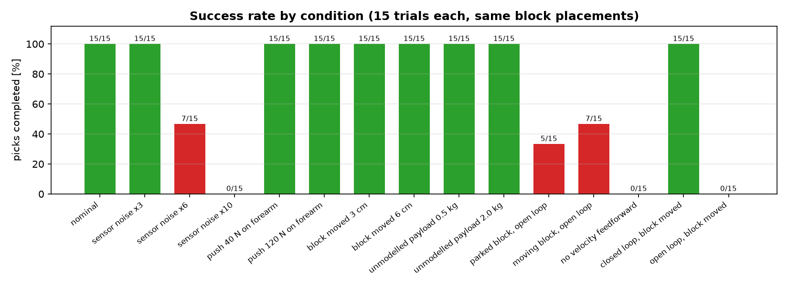
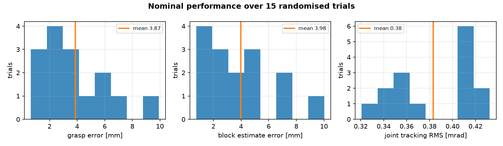

# Track B — Vision-guided pick with a UR3

**41014 Sensors and Control in Mechatronics Systems — Integrated Project**

A UR3 with a wrist-mounted RGB-D camera finds a red block **travelling across a
table on a belt**, works out where it is, which way round it is lying and how
fast it is going, and picks it up on the move. The red block is the only block
on the table.

Tracking a moving target is what makes the estimation earn its keep. The camera
reports a pose and nothing else, so the block's velocity is never measured —
the object filter infers it from how the pose changes, and the controller feeds
it forward to intercept the block instead of trailing behind it. Turn that one
term off and the success rate goes from 15/15 to 0/15: the tool settles a
steady `speed / gain` ≈ 14 mm behind a block only 30 mm wide, never gets inside
the 3 mm grasp tolerance, and the grasp never fires.

Nothing in the control loop ever reads the simulator's true state. The
controller runs on estimates: joint angles come from noisy, quantised encoders,
joint velocities are never measured at all, and the block's position comes from
the camera.

| | |
|---|---|
| Simulator | MuJoCo 3.15 |
| Robot model | `roboticstoolbox` UR3 (checked against the simulator: identical to 1e-12 m) |
| Sensors | 14-bit joint encoders (position only), 640×480 RGB-D at 15 Hz |
| Estimators | Kalman filter per joint on `[q, q̇, d]`; constant-velocity Kalman filter on the block's `[pose, velocity]` |
| Controller | Computed torque + LQR at 500 Hz, steered by PBVS with velocity feedforward |
| Target | Red block on a belt at 35 mm/s, heading redrawn each trial |
| Nominal result | 15/15 picks, grasp error 3.9 ± 2.4 mm, cycle 11.0 s |

---

## Running it

```bash
pip install mujoco roboticstoolbox-python control opencv-python matplotlib
```

The scripts are numbered and meant to be run in order. Part B writes the
calibration files that the later parts load.

```bash
python part_a_model.py         # state-space model, controllability, observability
python part_b_sensing.py       # camera calibration + how accurate it really is
python part_c_estimation.py    # the two Kalman filters
python part_d_control.py       # computed torque, LQR, visual servoing
python part_e_robustness.py    # repeated trials and disturbances  (~6 min)
python make_video.py           # renders a demo clip (see flags below)
```

`python part_e_robustness.py --quick` runs fewer trials if you just want to see
it work. `python run_all.py` runs everything in order, about 10 minutes.

### Demo clips

`make_video.py` renders one pick with the scene on the left and, on the right,
the object filter's estimate with its 1σ uncertainty beside the true state, the
inferred block speed beside the true speed, the joint estimate the controller is
actually running on, and the commanded torque against each motor's limit.

```bash
python make_video.py                 # nominal pick          -> results/demo_nominal.mp4
python make_video.py --nudge         # block knocked 4 cm    -> results/demo_nudge.mp4
python make_video.py --noise         # 6x sensor noise       -> results/demo_noise.mp4
python make_video.py --open-loop     # camera off after one look, block knocked
```

The open-loop clip is the control case: same disturbance, camera switched off,
gripper closes on empty table.

### How closely these numbers should reproduce

Every figure quoted on this page is printed by the scripts in this folder, and
the trials are seeded, so re-running them lands in the same place. They are not
bit-identical between runs, though, and it is worth saying why rather than
leaving a marker to wonder.

The depth image comes back from the OpenGL renderer, which is not guaranteed
bit-exact across runs (`mjDEPTH_ZEROFAR` falls back when `ARB_clip_control` is
unavailable, which it is here). A depth value that lands a fraction either side
of a threshold changes which pixels the detector keeps, which moves the
localisation by a few tenths of a millimetre, and the controller then follows a
slightly different path. Re-running Part C at the same seed moved its final
pre-grasp error between 1.6 mm and 2.0 mm.

So the **single-trial** numbers in Parts C and D are good to about one
significant figure, and should be read that way. The quantitative weight sits
on Part E, where every figure is a mean over repeated trials with the spread
reported alongside it.

| File | What is in it |
|---|---|
| `trackb.py` | Everything shared: the robot model, sensor models, vision, both filters, the controller, and the pick itself |
| `ur3_pick_scene.xml` | The MuJoCo scene — UR3, table, gripper, wrist camera, the red block |
| `assets/ur3/*.obj` | The UR3 link shells, one OBJ per material, converted from the `ur_description` DAE visuals. Drawn only |
| `assets/ur3/collision/*.stl` | The convex hulls the links are actually collided with. Group 3, so they are not drawn |
| `part_*.py` | One script per marking criterion. Each prints its results and saves figures to `results/` |

---

## How a pick goes

| Phase | What happens |
|---|---|
| `settle` | Let the controller take hold of the arm |
| `to_observe` | Quintic joint move to a pose about 0.33 m above the table |
| `look` | Camera starts. Find the red block, start the object filter. Nothing red in view: pan to the next look pose and try again |
| `align` | **PBVS** drives the tool to 120 mm above the estimated block position, lined up with its long side, matching its speed |
| `descend` | Same again, slower, down to 10 mm above the block's centre |
| `grasp` | Close the force-limited gripper — still travelling with the block, or it slides out of the jaws |
| `lift` | Take it off the belt, lift 150 mm and stop |

The block starts at the upstream edge of a 28 x 52 cm box on the table
(`BLOCK_X_RANGE`, `BLOCK_Y_RANGE`) and crosses it at `BLOCK_SPEED`, with its
angle, its direction of travel and a few degrees of off-axis heading redrawn
every trial. The box is wider than the wrist camera's view from one pose, so
`look` sweeps up to three shoulder-pan angles (`OBSERVE_SWEEP_DEG`) until the
red block appears; `info` reports how many looks it took. `watch.py` and
`make_video.py` draw a fresh seed each run and print it, so a run can be
repeated with `--seed <n>`.

`run_pick(block_speed=0)` parks the block, which is how Part B wants the world
and what the old stationary-target results were measured against.

In the scene, the belt is one `<contact><pair>` between the block and the table
that drops that contact's friction to 0.02. Without it the table would stop the
block in a few milliseconds. The finger pads keep their own friction of 1.5, so
the grasp is unaffected.

---

## Frames

A pose `T_AB` takes a point in frame B and gives it in frame A.

| Frame | Where it is |
|---|---|
| `world` | On the floor, z up |
| `base_link` | The robot's base, bolted to the table at z = 0.6 m |
| `tool0` | The flange, z pointing out of it |
| `tcp` | Between the finger pads, 105 mm out along tool z |
| camera | Optical convention: x right, y down, z forward |

Going from a camera pixel to something the controller can use:

```
block pose in base frame  =  FK(q̂)  ·  T_tool_cam  ·  (back-projected pixel)
                              ▲          ▲              ▲
                              │          │              └─ depth of the pixel
                              │          └─ hand-eye calibration (Part B)
                              └─ forward kinematics of the ESTIMATED angles
```

Two conventions that are easy to get wrong, and did catch us out:

- **MuJoCo cameras look along their own −z with y up.** Every calibration
  routine assumes x right, y down, z forward. `MUJOCO_TO_OPTICAL` in
  `trackb.py` is the only place that conversion happens.
- **A parallel gripper is unchanged by a 180° turn**, so the block's angle only
  means anything modulo π. Everything is wrapped by `wrap_pi_2`, and the grasp
  picks whichever of the two equivalent wrist angles needs less turning.

---

## Part A — Modelling

`python part_a_model.py`

The arm obeys `M(q)q̈ + c(q,q̇) + g(q) + Bq̇ = τ`. Linearised about the pose
used to look at the table, with `x = [δq, δq̇]`:

```
A = [[0, I], [−M⁻¹G, −M⁻¹B]]      B = [[0], [M⁻¹]]      G = ∂g/∂q
```

The largest open-loop eigenvalue is **+3.42 s⁻¹** — the arm is unstable under
its own weight, so the controller is holding it up, not just steering it.

### Controllability and observability

Checked with the **PBH test**, one eigenvalue at a time, rather than the rank
of `[B, AB, …, A¹¹B]`. That matters here:

```
rank(ctrb(A,B)) straight from numpy :  9 / 12   <-- wrong
PBH test                            : 12 / 12   <-- right
```

The controllability matrix's singular values span about ten decades, so its
numerical rank is meaningless. This is a real trap, not a technicality.

| Sensors | controllable | observable |
|---|---:|---:|
| 6 torque motors, 6 position encoders | **12 / 12** | **12 / 12** |
| velocity sensors instead of encoders | — | 11 / 12 |
| encoders on joints 2–6 (pan encoder dead) | — | 11 / 12 |

The first row is the one that justifies the whole design: **with position
encoders alone, all six joint velocities are observable.** That is why the
robot has no tachometers and Part C estimates velocity instead.

With velocity sensors only, the shoulder-pan angle is lost — turning about the
vertical axis changes no gravity torque and no velocity reading, so a constant
offset in it is invisible.

### After feedback linearisation

Computed torque turns the coupled 12-state problem into six identical double
integrators, `q̈ = v`, so one small controller design serves all six joints. The
observer adds a third state `d` for the acceleration the model did not predict.
`d` is not controllable (it is not ours to steer) but it **is** observable from
position alone, which is what lets the observer estimate it.

---

## Part B — Sensing

`python part_b_sensing.py`

### Calibration

20 photos of a 9×6 checkerboard from assorted distances, tilts and roll angles.
Intrinsics by Zhang's method; hand-eye by solving `AX = XB`, using the
**encoder-measured** arm poses, not the simulator's true ones.

| | result |
|---|---|
| Reprojection error | 0.08 px |
| Hand-eye position error | 0.4 mm |
| Hand-eye angle error | 0.03° |

Three hand-eye solvers (Tsai, Park, Daniilidis) are compared. The script also
reports a check that needs **no ground truth**: the board never moves, so its
position computed through every view should come out the same each time, and
the scatter of those answers measures the residual. That check would work
unchanged on the real robot.

### How accurate is it really?

40 frames of the same block at six different camera heights:

| camera range | spread in z | bias in z |
|---:|---:|---:|
| 0.16 m | 0.08 mm | +0.58 mm |
| 0.24 m | 0.18 mm | +0.80 mm |
| 0.36 m | 0.41 mm | +1.29 mm |

**The measurement is precise but not accurate.** The frame-to-frame spread is a
few tenths of a millimetre, but the answer sits over a millimetre away from the
truth. The block measures 1–2 mm taller than it is, because its top face and
the surrounding table are both estimated from depth and the smooth part of the
depth error does not cancel between them.

So `R` is fitted to the **RMS error about the true position**, not to the
spread. A filter tuned on the spread alone would claim ±0.3 mm while being
1.5 mm out, and its gate would start throwing away perfectly good measurements.

`R` depends on range, so a frame taken from far away is automatically trusted
less than a close one — which is why the estimate tightens as the arm descends.

### The depth sensor model

Depth error is modelled in three parts, and the reason is worth stating: with
independent per-pixel noise alone, averaging over a 5000-pixel blob cancels it
almost completely and the block gets localised to 0.02 mm, which no real RGB-D
camera manages. The parts that **don't** average away are a smooth per-frame
bias field (neighbouring pixels share nearly the same error) and disparity
quantisation. Those set the real accuracy floor.

---

## Part C — Estimation

`python part_c_estimation.py`

### Joint observer

One Kalman filter per joint on `[q, q̇, d]`, running at 500 Hz.

**Velocity is never measured.** The obvious alternative is to difference the
encoder, which needs no model at all — so that is the fair comparison:

| | velocity error |
|---|---:|
| difference the encoder | 363 mrad/s |
| Kalman filter | **40 mrad/s** |

Nine times better. Differencing amplifies quantisation: one encoder count
(0.38 mrad) over a 2 ms step is already 0.19 rad/s of noise, and that lands
straight on the controller's `kd` term.

**`d`** absorbs what the model gets wrong — Coulomb friction, which the
controller deliberately does not model, and the block's weight once it is
picked up. Cancelling it in the controller is worth a lot:

| | tracking error |
|---|---:|
| `d` fed forward | **0.41 mrad** |
| `d` ignored | 5.51 mrad |

That is how steady-state droop is removed without putting an integrator in the
controller — no wind-up, and `d` is a signal you can plot.

### Is the filter honest?

NEES compares the actual error against the covariance the filter claims; an
honest filter averages about 2.

| σ_a | σ_d | NEES | velocity error | tracking |
|---:|---:|---:|---:|---:|
| 2 | 20 | 12.3 | 23.6 mrad/s | 0.57 mrad |
| 2 | 60 | **8.9** | **39.7** | **0.41** |
| 2 | 150 | 6.6 | 62.3 | 0.30 |
| 10 | 300 | 5.2 | 88.5 | 0.31 |

More process noise makes the filter more honest but blurs the velocity
estimate. We use σ_a = 2, σ_d = 60.

**NEES stays near 9 rather than 2, and that is worth being straight about.**
The dominant error is not random: Coulomb friction flips sign the instant a
joint reverses, which is a step, not a random walk, and no amount of process
noise describes a step well. Forcing NEES to 2 by inflating Q just blurs the
estimate for nothing.

### Object filter

Kalman filter on `[x, y, z, yaw]`, updated by every camera frame, with `R`
recomputed per frame from that frame's range. A χ² gate rejects outliers; four
consecutive rejections are read as "the block actually moved" and the filter
re-initialises there. That recovery is what makes the nudge test in Part E work.

### What happens when the block leaves the view

Roughly 30% of the camera frames in a normal run return no detection (62 used,
26 blind in the run plotted here). As
the gripper descends, the block drops out of the wrist camera's field of view —
the camera is mounted off to one side of the tool, so at close range it cannot
see what the gripper is about to grasp.

The filter coasts: updates stop, its own uncertainty grows to say so, but the
actual error stays flat because the block has not moved. The robot finishes the
grasp on the estimate it had while it could still see.

This is a real limitation of an eye-in-hand camera rather than a bug. A second
fixed camera would fix it.

---

## Part D — Control

`python part_d_control.py`

```
τ = M(q̂)·v + c(q̂,q̇̂) + g(q̂) + B·q̇̂          computed torque
v = q̈* − kp(q̂ − q*) − kd(q̇̂ − q̇*) − d̂       LQR on the double integrator
```

Everything on the right is an estimate or a reference. LQR weights by Bryson's
rule, so they have units you can argue about:

| | |
|---|---|
| `e_max`, `v_max`, `a_max` | 0.005 rad, 0.125 rad/s, 5 rad/s² |
| `kp`, `kd` | 942 s⁻², 57.5 s⁻¹ |
| closed loop | 32 rad/s, damping 0.95 |

Why not just turn the gains up? `kd` multiplies the velocity **estimate**, and
that estimate carries noise:

| `e_max` | kp | kd | settling | noise into torque |
|---:|---:|---:|---:|---:|
| 0.002 | 2305 | 77.3 | 78 ms | 3.09 rad/s² |
| **0.005** | **942** | **57.5** | **166 ms** | **2.30** |
| 0.02 | 239 | 44.0 | 646 ms | 1.76 |

On the real pick this gives **0.41 mrad** RMS tracking, with peak torque 23.3 N m
against limits of 56/56/28/12/12/12. On a 0.25 m forearm 0.41 mrad is about
0.1 mm at the tool — so the controller is not what limits grasp accuracy. The
vision is.

### Visual servoing

```
error = block pose − tool pose           twist = gain · error, capped
q̇* = J(q̂)⁺ · twist                       damped least squares
```

The goal is recomputed from the object filter on **every control step**, so a
new camera frame immediately changes where the arm is heading. `J` is inverted
with damping rather than exactly: near a singular configuration a true inverse
asks for joint speeds the motors cannot deliver.

---

## Part E — Integration and robustness

`python part_e_robustness.py`

15 trials per condition, reusing the same 15 block placements each time so a
difference between rows is the condition and not luck about where the block
landed.

| Condition | Picked up | Grasp error | Block estimate error |
|---|---:|---:|---:|
| nominal | 15/15 | 3.87 mm | 3.98 mm |
| sensor noise ×3 | 15/15 | 9.33 mm | 9.78 mm |
| sensor noise ×6 | **7/15** | 14.81 mm | 15.90 mm |
| sensor noise ×10 | **0/15** | — | — |
| 40 N shove to the forearm | 15/15 | 3.69 mm | 3.84 mm |
| 120 N shove | 15/15 | 4.14 mm | 4.23 mm |
| block knocked 3 cm mid-approach | 15/15 | 4.73 mm | 4.87 mm |
| block knocked 6 cm mid-approach | 15/15 | 3.55 mm | 3.69 mm |
| unmodelled 0.5 kg payload | 15/15 | 3.49 mm | 3.58 mm |
| unmodelled 2.0 kg payload | 15/15 | 3.84 mm | 3.95 mm |

Nominal grasp error over 15 trials: **3.87 ± 2.42 mm**, cycle time 11.0 s.





Read the mechanical disturbances and the sensor noise rows differently. A
120 N shove to the forearm does not move the grasp error at all, because the
controller sees it as a disturbance, the observer's `d` state absorbs it, and
the block never moved. Neither does an unmodelled 2 kg payload. Knocking the
block across the table costs about a millimetre, because the filter has to
notice, reject and re-initialise before the arm can follow. **Everything
mechanical is cheap; only the sensing is expensive.** That is the honest
summary of this table, and it is the opposite of what we expected before
running it.

**Where it breaks, and why.** Sensor noise is the one axis that defeats it, and
it does so in two distinct ways:

- **At ×6 noise: 7/15.** The failures are `did not lift it` (5) and `descend
  took too long` (3). The block estimate error has risen from 3.98 mm to
  15.90 mm — half a block width — so the gripper is being sent to a place the
  block is not, closes on the table edge, and comes up empty. **This is the
  failure mode to worry about**, because the robot does not know it failed. It
  commits to a bad estimate and reports a completed grasp.
- **At ×10 noise: 0/15, every one `align took too long`.** Here the estimate is
  jumping by more than the 3 mm arrival tolerance faster than the arm can
  settle inside it, so the align phase never completes. This failure is the
  benign one: the robot gives up rather than grasping the wrong place.

Those two are worth separating because the obvious fix points in opposite
directions. Loosening the arrival tolerance would convert ×10 timeouts into
completed-but-wrong grasps, which is worse. The real fix is more averaging
before committing — trading cycle time for a better estimate — and a check that
refuses to close the gripper when the filter's own covariance is too wide to
justify it. The filter already reports that uncertainty; nothing currently acts
on it.

### Does closing the loop through vision actually matter?

Easy to claim, so here is the test. "Open loop" means the robot looks once,
switches the camera off, and drives to where it thought the block was.

| | Picked up | Grasp error |
|---|---:|---:|
| closed loop, nominal | **15/15** | 3.87 mm |
| closed loop, block knocked 4 cm | **15/15** | 5.45 mm |
| open loop, block parked | 5/15 | 19.89 mm |
| open loop, block moving | 7/15 | 11.27 mm |
| open loop, block knocked 4 cm | **0/15** | — |
| no velocity feedforward | **0/15** | — |

Three things in that table, and only the third is the one we set out to test.

**Open loop fails even with nothing disturbing the block** — 5/15 with it
parked. That is not what we predicted, and the reason is the motion model. A
constant-velocity filter with nothing left to correct it does not sit still, it
*extrapolates* along whatever velocity it happened to infer from its first three
frames. Guess 10 mm/s wrong and six seconds of approach turns that into 60 mm
of error. An earlier constant-position version of this filter had no velocity to
be wrong about and so degraded gracefully instead. **The motion model is what
lets the robot coast through the blind frames at the end of the descent, and it
is also what makes running without measurements dangerous.** A motion model is
only worth having while something keeps correcting it. That trade is a direct
consequence of the design choice in Part C, and it cuts both ways.

**Velocity feedforward is load-bearing: 0/15 without it.** Nothing is broken in
that run — the camera is running, the filter is tracking the block to a few
millimetres, the arm is healthy. It simply never closes. A proportional law
settles at a steady `error = speed / gain`, about 14 mm at belt speed, against a
block 30 mm wide and a 3 mm grasp tolerance, so the tool trails the block across
the table until the phase times out. It is the plainest demonstration in this
project that **estimating a state and using it are two different things**.

**And the comparison we meant to run:** with the block knocked 4 cm after the
robot has locked on, closed loop is 15/15 and open loop is 0/15. With the camera
running, the filter sees measurements that disagree with its estimate, gates
them out, and after four consecutive rejections concludes the block has really
moved and re-initialises there. Open loop there is nothing to notice with, and
the gripper closes on empty table.

One caveat on reading that table: the two open-loop rows are separate
experiments, not a matched pair. A parked block is drawn from the whole table
while a moving one always starts at the upstream edge, so the placements differ
and the two success rates are not comparable like for like.

---

## What we got wrong on the way

**The textbook rank test gave the wrong answer.** `rank(ctrb(A,B))` reported
9/12 for a system that is fully controllable, because the matrix is terribly
conditioned. Switching to PBH fixed it. We would not have caught this without
cross-checking against the physics — the arm obviously *is* controllable.

**Our first depth sensor model was far too kind.** Independent per-pixel noise
averages away over a big blob, so the block was being localised to 0.02 mm.
Adding correlated bias and disparity quantisation moved it to a believable
1.4 mm.

**We nearly tuned the object filter on the wrong statistic.** The measurement's
repeatability is ten times smaller than its actual error, so a filter tuned on
repeatability would have been badly over-confident.

**The eye-in-hand camera goes blind exactly when it matters most.** A camera on
the wrist cannot see what the gripper is closing on. The system handles it by
committing to its last good estimate, but a second fixed camera is the proper
answer.

---

## Where ground truth is used

The brief asks that simulator ground truth be used only for evaluation, and
that this is visible in the code. Every function that reads it has `true_` in
its name — `true_q`, `true_qd`, `true_object_pose`, `true_tcp`,
`true_camera_pose` — and they are only ever called to fill the log, to score a
trial, or to print a calibration error. Searching for `true_` finds all of them.

The controller and the observer receive exactly two things from the robot:
`read_encoders()` and `capture_rgbd()`.

---

## Contribution statement

<!-- Replace before submitting. -->

| Member | Contribution |
|---|---|
| | |

---

## Generative AI declaration

<!-- Replace with your team's own wording before submitting. -->

Anthropic's Claude (Claude Code) was used to help write and debug the
simulation, the estimator and controller code, and this document. All code was
reviewed and run; every number quoted here is printed by the scripts in this
folder.
